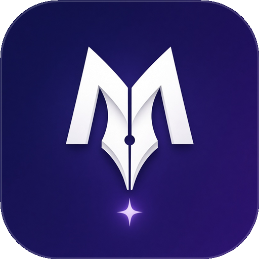
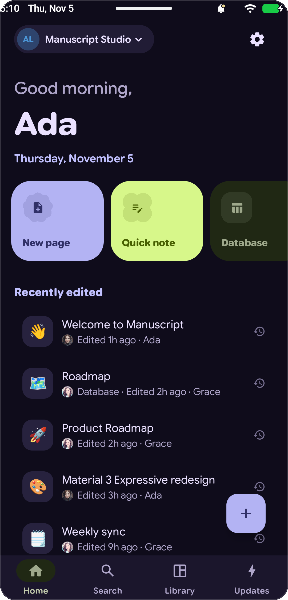
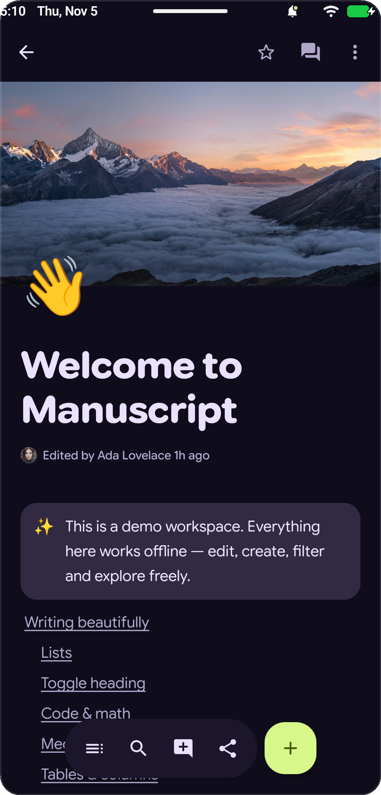
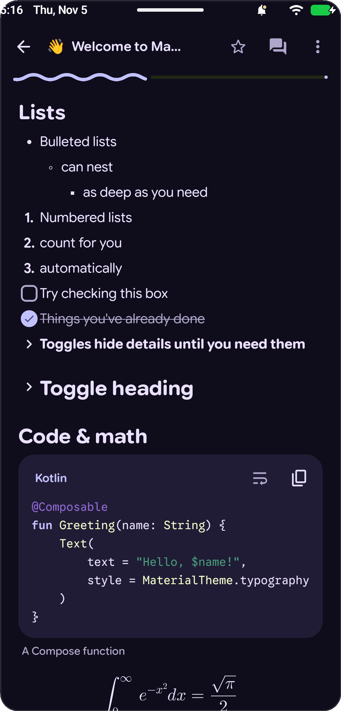
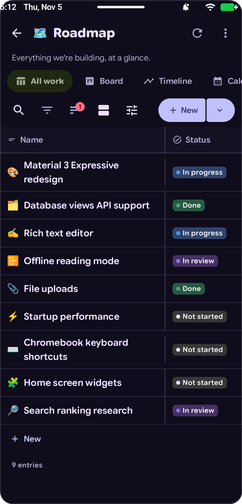
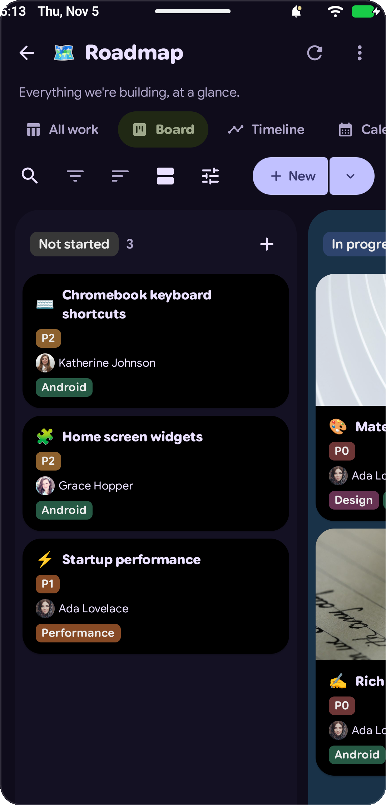
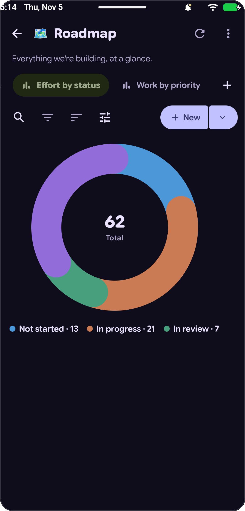
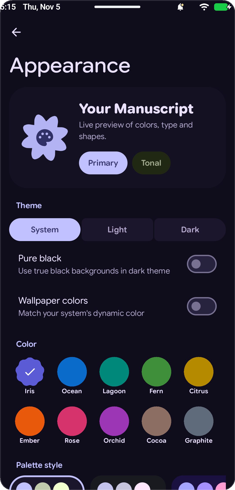

<div align="center">



# Manuscript

### **A native Android client for Notion, built with Material 3 Expressive.**

Fast, offline-first, and designed from the ground up with Jetpack Compose — so your notes, wikis, and databases feel right at home on your phone, foldable, tablet, or Chromebook.

<p align="center">
  <a href="https://github.com/YashjitPal/Manuscript/releases/download/v1.0.0/Manuscript-v1.0.0.apk">
    
  </a>
  <a href="https://github.com/YashjitPal/Manuscript/releases/latest">
    
  </a>
  
  
</p>

</div>

---

## Screenshots

### Home, Rich Pages & Code / Math

<p align="center">
  
  &nbsp;
  
  &nbsp;
  
</p>

### Databases, Charts & Custom Themes

<p align="center">
  
  &nbsp;
  
  &nbsp;
  
  &nbsp;
  
</p>

---

## What Makes Manuscript Different

Most mobile note apps wrap a desktop website inside a webview — taking seconds to open a page and feeling laggy when you just want to jot something down. **Manuscript** is 100% native Android UI talking directly to your workspace with local on-device caching.

- **Instant & Offline-Ready** — Pages and blocks are cached locally on your device so they open immediately, even when you're offline. Want to try the app before connecting your account? Tap **Explore the demo workspace** on the welcome screen for a full offline workspace out of the box.
- **Fluid Block Editor** — Type `/` to insert any block, `@` to mention people, dates, or pages, or use the floating toolbar to format text, change colors, indent items, and insert lines above or below with a single tap.
- **Every Block Rendered Natively** — Headings, collapsible toggles, toggle headings, checklists, callouts, quotes, multi-column layouts, tabs, tables, syntax-highlighted code blocks (70+ languages), LaTeX math equations, native PDF viewer, audio player, and pinch-to-zoom images.
- **Real Database Views** — Switch seamlessly between **Table**, **Board** (with drag-and-drop cards), **Calendar**, **Timeline**, **Gallery**, **List**, **Form**, **Map**, **Chart** (donut, bar, column, line), and **Dashboard** views. Filter, sort, and group your entries on the fly.
- **Material 3 Expressive & Custom Fonts** — Match your Android 12+ wallpaper colors automatically, or pick from 10 curated accent colors (*Iris, Ocean, Lagoon, Fern, Citrus, Ember, Rose, Orchid, Cocoa, Graphite*), 9 palette styles, and a **Pure Black** OLED mode. Switch your reading font between **Google Sans Flex** (with adjustable roundness), **Newsreader** (Serif), and **Google Sans Code** (Mono).
- **Scales Across Every Screen** — Adapts from one-handed phone navigation to a resizable sidebar, two-pane side peek, live heading outline, and full hardware keyboard shortcuts on tablets, foldables, and Chromebooks.

---

## Download & Install

1. **[Download `Manuscript-v1.0.0.apk`](https://github.com/YashjitPal/Manuscript/releases/download/v1.0.0/Manuscript-v1.0.0.apk)** from the [Releases page](https://github.com/YashjitPal/Manuscript/releases/latest).
2. Open the downloaded `.apk` file on your Android device to install it.
3. Sign in with **Continue with Notion**, paste a personal/internal token, or tap **Explore the demo workspace** to test everything right away.

---

<details>
<summary><b>Building from source</b></summary>
<br>

Requires JDK 17+ and the Android SDK.

```bash
git clone https://github.com/YashjitPal/Manuscript.git
cd Manuscript
./gradlew assembleRelease
```

The signed release APK will be generated at `app/build/outputs/apk/release/app-release.apk`.
</details>

---

## License

Released under the Apache 2.0 License. Notion is a trademark of Notion Labs, Inc. Manuscript is an independent project and is not affiliated with Notion.
